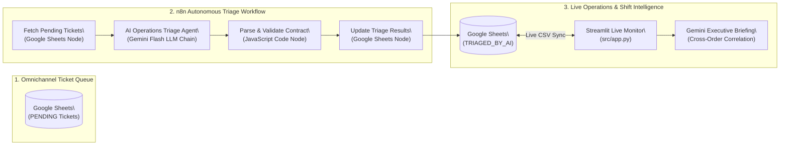
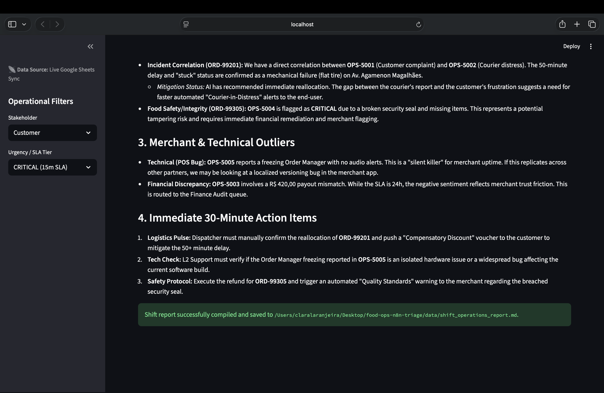
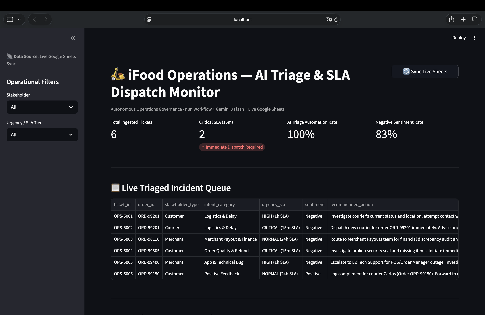
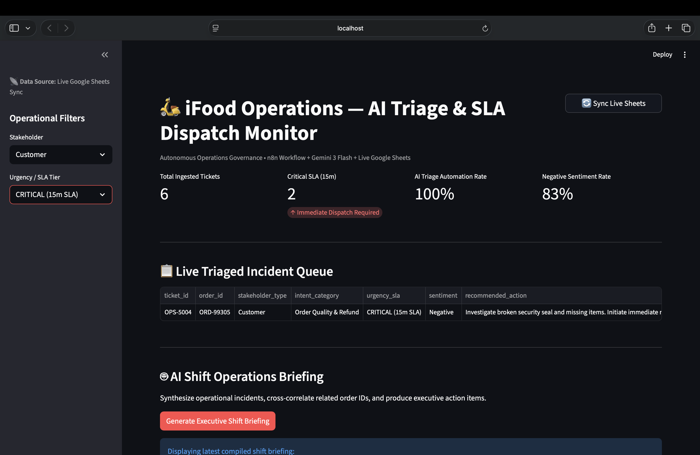
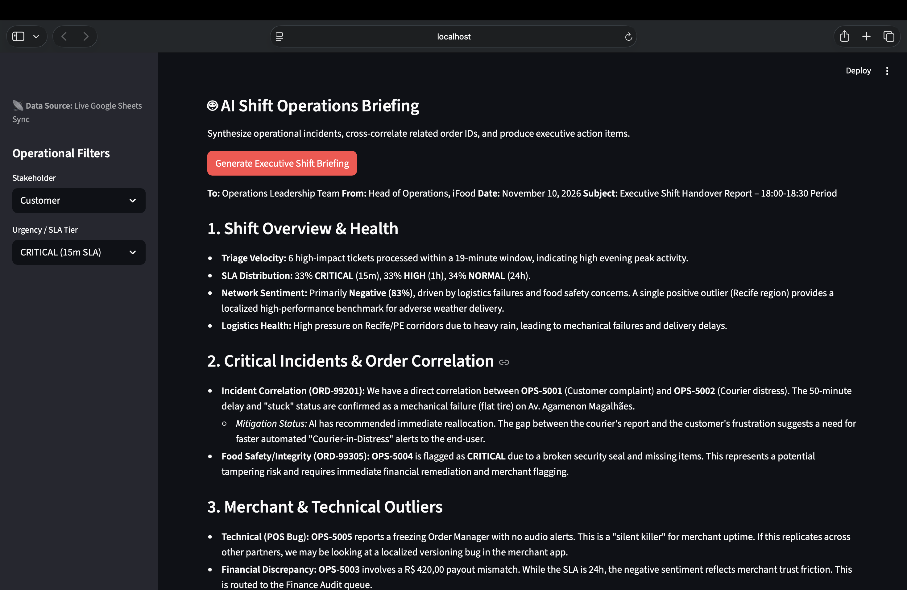

# Autonomous Food Delivery Operations Triage & SLA Dispatcher


An end-to-end **Autonomous Operations Triage Pipeline and Live SLA Dispatch Monitor** built for high-volume three-sided food delivery marketplaces (**Customers, Merchants, and Couriers**).

Powered by **n8n**, **Google Gemini 3 Flash**, **Google Sheets**, and **Streamlit**, this system eliminates manual support routing bottlenecks by autonomously classifying incoming operational incidents, enforcing deterministic SLA tiers, drafting empathetic responses in Portuguese, and cross-correlating multi-stakeholder order incidents in real time.

---

## Business Problem & Operational Impact

High-frequency food delivery platforms process thousands of concurrent support events during peak meal shifts. When a critical in-transit incident occurs—such as a courier mechanical breakdown (`ORD-99201`) simultaneous with a customer delay complaint on the same order—manual first-in-first-out (FIFO) queues fail to prioritize urgent logistics interventions over routine billing inquiries.

### Key Capabilities Delivered
* **Zero-Touch Multi-Stakeholder Triage:** Automatically classifies unstructured support messages across **Customer**, **Merchant**, and **Courier** channels via an n8n + Gemini Flash pipeline (100% triage automation rate).
* **Deterministic SLA Routing:** Enforces strict response tiers:
  * `CRITICAL (15m SLA)`: Active in-transit courier emergencies, order reallocation, or food safety/tampering breaches.
  * `HIGH (1h SLA)`: Severe order delays (>45 min) or Merchant POS/Order Manager outages during live shifts.
  * `NORMAL (24h SLA)`: Financial payout reconciliations and positive courier commendations.
* **Cross-Incident Order Correlation:** The Streamlit Executive Shift Briefing agent automatically detects when separate tickets from a Customer (`OPS-5001`) and a Courier (`OPS-5002`) refer to the same `order_id` (`ORD-99201`), synthesizing unified dispatch instructions.
* **Live Cloud Synchronization:** Direct real-time synchronization between the Google Sheets state store and the Streamlit monitoring interface with local CSV fallback caching.

---

## System Architecture



---

## Visual Evidence & Live Execution

### 1. Autonomous n8n Triage Workflow (`6 items` Batch Execution)


### 2. Streamlit Live Operations & SLA Dispatch Monitor


### 3. Dynamic SLA & Stakeholder Filtering (`CRITICAL 15m SLA`)


### 4. AI Executive Shift Briefing & Cross-Order Correlation (`ORD-99201`)


---

## Data Contract & AI Schema

The n8n `Parse & Validate JSON Contract` node enforces a strict schema on every Gemini Flash completion before writing back to Google Sheets:

```json
{
  "ticket_id": "OPS-5002",
  "stakeholder_type": "Courier",
  "intent_category": "Logistics & Delay",
  "sentiment": "Negative",
  "urgency_sla": "CRITICAL (15m SLA)",
  "recommended_action": "Dispatch new courier for order ORD-99201 immediately. Advise original courier on safety protocols.",
  "suggested_reply": "Que bom que você está em segurança! Já acionamos um entregador de apoio para retirar o pedido ORD-99201 na sua localização...",
  "status": "TRIAGED_BY_AI"
}
```

---

## Repository Structure

```text
food-ops-n8n-triage/
├── assets/
│   ├── n8n_workflow_screenshot.png      # Verified n8n workflow execution canvas
│   ├── streamlit_dashboard.png          # Main Streamlit operations monitor
│   ├── streamlit_filtered_sla.png       # Filtered CRITICAL (15m SLA) queue view
│   └── ai_shift_briefing.png            # AI-generated executive shift briefing
├── data/
│   ├── support_tickets.csv              # Initial untriaged seed dataset (PENDING)
│   ├── triaged_support_tickets.csv      # Live synced dataset populated by n8n + Gemini
│   └── shift_operations_report.md       # AI-generated executive shift handover report
├── src/
│   ├── __init__.py
│   ├── config.py                        # Environment, paths, and live Google Sheets endpoint
│   ├── seed_tickets.py                  # Deterministic generator for operational test cases
│   └── app.py                           # Streamlit SLA monitor & Executive Briefing agent
├── workflows/
│   └── food_delivery_triage_workflow.json # Exported n8n workflow template (import-ready)
├── .env.example                         # Environment variable template
├── requirements.txt                     # Python dependencies
└── README.md                            # Project documentation
```

---

## Quickstart & Reproduction

### 1. Clone & Configure Environment
```bash
git clone https://github.com/claramtenorio/food-ops-n8n-triage.git
cd food-ops-n8n-triage
python3 -m venv .venv
source .venv/bin/activate
pip install -r requirements.txt
cp .env.example .env
```
Add your `GEMINI_API_KEY` inside `.env`.

### 2. Import & Run the n8n Workflow
1. Open your **n8n** instance and select **Import from File...**
2. Upload `workflows/food_delivery_triage_workflow.json`.
3. Connect your **Google Sheets OAuth2** credential and **Google Gemini API Key**.
4. Click **Execute Workflow** to process all `PENDING` rows and write back structured triage metadata.

### 3. Launch the Live Operations Monitor
```bash
streamlit run src/app.py
```
Click **🔄 Sync Live Sheets** to pull the latest state from Google Sheets and **Generate Executive Shift Briefing** to run cross-order incident synthesis.